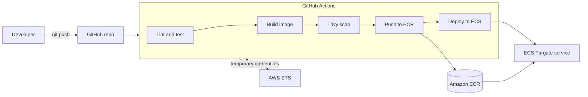

# CI/CD Pipeline on AWS

[](https://github.com/MadhukaD/cicd-aws-pipeline/actions/workflows/ci.yml)

A small Flask service with a complete CI/CD pipeline: every push to `main`
is linted, tested, built into a Docker image, scanned for vulnerabilities,
pushed to Amazon ECR, and deployed to ECS Fargate. No long-lived AWS keys
are stored anywhere.

## Architecture



## Pipeline stages

| Stage | What it does | Why |
|---|---|---|
| Lint and test | Ruff and pytest | Cheap checks first, so failures show up fast |
| Build | Docker build, tagged with the commit SHA | Every image traces back to exact code |
| Scan | Trivy fails on fixable HIGH or CRITICAL findings | The scan is a gate, not just a report |
| Push | Image goes to ECR | Only runs on `main`, only after the scan passes |
| Deploy | New ECS task definition revision, then wait for the service to stabilise | A failed rollout turns the pipeline red |

## Security decisions

- **OIDC instead of access keys:** GitHub Actions assumes an IAM role with
  short-lived credentials. The trust policy is limited to this repo and the
  `main` branch.
- **Least privilege:** the role can push to one ECR repo and update one ECS
  service, and it can pass one specific execution role.
- **Pinned third-party actions:** pinned to commit SHAs, after the March 2026
  compromise of Trivy's GitHub Action.
- **Non-root container**, slim base image, OS packages patched at build time.
- **Immutable image tags**, so a tag can never be silently overwritten.
- **Narrow workflow permissions:** `contents: read` by default, and
  `id-token: write` only on jobs that need AWS.

## Project layout

```
app/                 Flask application
tests/               pytest tests
Dockerfile           Production image (non-root, gunicorn)
.github/workflows/   CI/CD pipeline
```

## Run locally

```bash
python -m venv .venv
source .venv/bin/activate        # Windows Git Bash: source .venv/Scripts/activate
pip install -r requirements-dev.txt
pytest

docker build -t cicd-demo:local .
docker run --rm -p 8000:8000 -e APP_VERSION=local cicd-demo:local
# open http://localhost:8000/ and /health
```

## Deployment notes

- The deployed `/` endpoint returns the commit SHA in `version`, so you can
  verify which commit is running.
- This project uses a public task IP restricted by security group, to keep
  costs low. A production setup would use an ALB, private subnets, and TLS.

How this was built: see [BUILD-GUIDE.md](/docs/BUILD-GUIDE.md)

## What I learned

- Debugging OIDC trust failures: the token's `sub` claim format must match
  the trust policy exactly.
- Gunicorn sync workers can be blocked by idle connections, so I switched
  to threaded workers.
- Why `iam:PassRole` exists and how to scope it.

## Possible next steps

- Rebuild the infrastructure with Terraform (ALB, private subnets, TLS)
- Branch protection and a post-deploy smoke test
- Automatic rollback on failed deployments